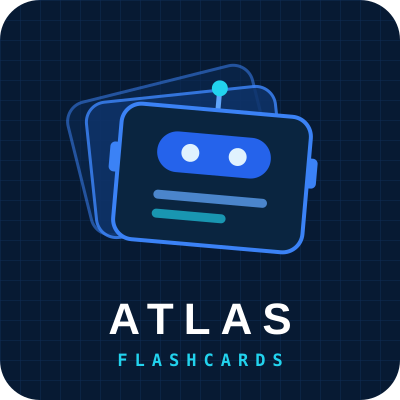
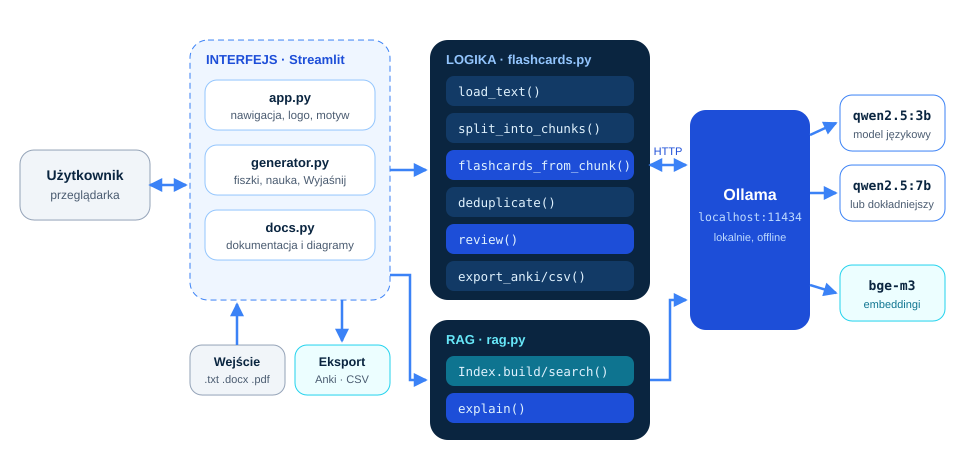
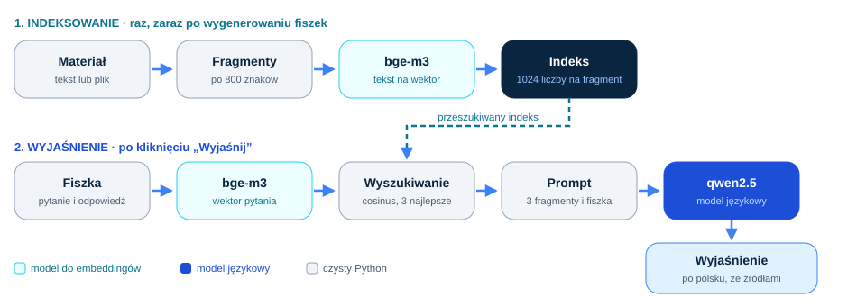

# ATLAS: Flashcards

Fiszki do nauki z Twoich materiałów, generowane lokalnym modelem językowym przez [Ollamę](https://ollama.com).
System z jednym agentem: ten sam model pisze fiszki, ocenia ich jakość i wyjaśnia je na podstawie materiału (RAG).

Strona projektu: <https://atlas.juliuszlosinski.com/flashcards.html>


## Funkcje

- **Dowolne materiały:** wklejony tekst albo pliki .txt, .docx i .pdf.
- **Lokalny model:** Qwen 2.5 przez Ollamę, bez kluczy API i bez chmury.
- **Ustrukturyzowane wyjście:** schemat Pydantic przekazywany do modelu jako format JSON.
- **Kontrola jakości:** LLM-as-judge ocenia każdą fiszkę w skali 1-5, duplikaty są usuwane.
- **Wyjaśnienia ze źródłami (RAG):** przycisk Wyjaśnij w trybie nauki wyszukuje fragmenty materiału modelem `bge-m3` i tłumaczy na ich podstawie.
- **Nauka i eksport:** tryb nauki, edycja fiszek, eksport do Anki i CSV.

## Uruchomienie

Wymagania: Python 3.12 i Ollama.

```bash
ollama pull qwen2.5:3b
ollama pull bge-m3
pip install -r requirements.txt
python -m streamlit run app.py
```

Testy (bez modelu, z atrapą):

```bash
python -m unittest discover tests
```

## Architektura



| Plik | Rola |
|---|---|
| `app.py` | punkt wejścia: nawigacja, logo, motyw |
| `generator.py` | strona generatora: ustawienia, generowanie, nauka, przycisk Wyjaśnij |
| `docs.py` | wbudowana dokumentacja z diagramami |
| `flashcards.py` | logika: wczytywanie, podział na fragmenty, generowanie, ocena, deduplikacja, eksport |
| `rag.py` | RAG: indeks wektorowy w pamięci i wyjaśnienia ze źródłami |
| `ollama_models.py` | lista pobranych modeli, katalog do pobrania, pobieranie |
| `theme.py` / `diagrams.py` | wygląd i diagramy SVG |

## RAG



1. Materiał jest dzielony na fragmenty po ok. 800 znaków, a `bge-m3` zamienia każdy na wektor.
2. Pytanie i odpowiedź z fiszki też stają się wektorem; podobieństwo cosinusowe wybiera 3 najbliższe fragmenty.
3. Model językowy dostaje ponumerowane fragmenty i odpowiada po polsku, powołując się na nie jako [1], [2].
