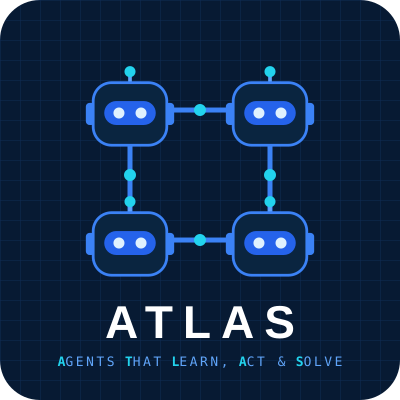
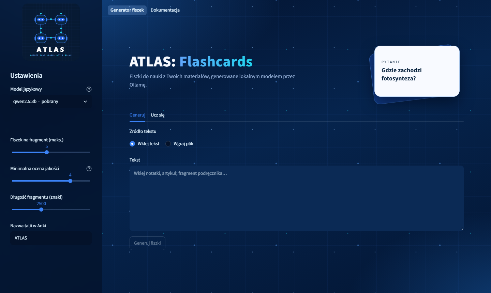

<p align="center">
  
</p>

<h1 align="center">ATLAS</h1>
<p align="center"><b>Agents That Learn, Act &amp; Solve</b></p>
<p align="center">Portfolio projektów z modelami językowymi, modelami multimodalnymi i agentami AI.</p>
<p align="center"><a href="https://atlas.juliuszlosinski.com/">Strona projektu</a> · <a href="https://atlas.juliuszlosinski.com/mapa.html">Mapa projektów</a></p>

---

Każdy projekt ATLAS to osobny folder z kodem, testami i instrukcją uruchomienia.

| Projekt | Opis | Technologie | Status |
|---|---|---|---|
| [ATLAS Flashcards](Flashcards/) | Fiszki do nauki z własnych materiałów, generowane lokalnym modelem. Ocena jakości przez LLM-as-judge, wyjaśnienia z RAG, eksport do Anki. | Python, Streamlit, Ollama, Pydantic, RAG | gotowy |



## Struktura repozytorium

```
ATLAS/
  Flashcards/   projekt 01: generator fiszek (Streamlit + Ollama)
  docs/         strona GitHub Pages: portfolio i opisy projektów
```

## Autor

Juliusz Łosiński · [github.com/juliuszlosinski](https://github.com/juliuszlosinski)
