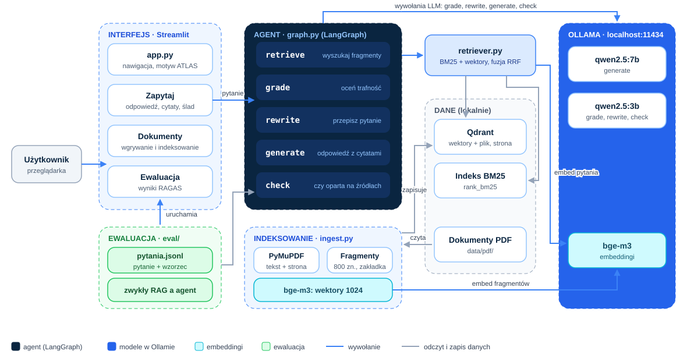
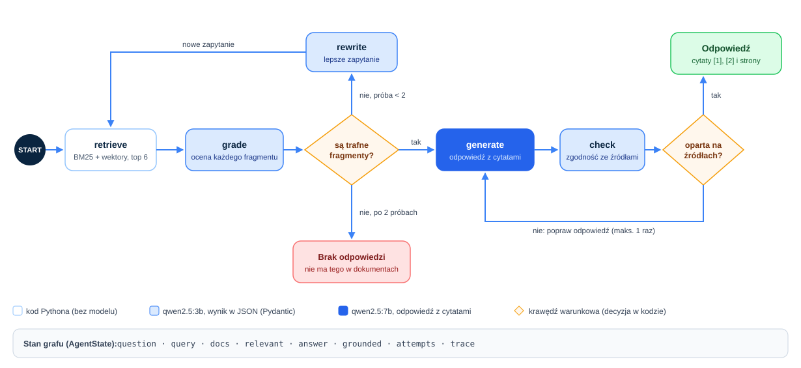

# ATLAS Scholar: architektura

Agentowy RAG po dokumentach PDF. Scholar odpowiada na pytania o zbiór publikacji, podaje cytaty z numerem strony
i sam decyduje, czy znalezione fragmenty wystarczą. Jeśli nie, przepisuje pytanie i szuka ponownie, a gdy odpowiedzi
w dokumentach nie ma, mówi to wprost zamiast zgadywać.

Projekt 02 z [mapy ATLAS](https://juliuszlosinski.github.io/ATLAS/mapa.html). Krok 1 z 4: architektura i diagram.

## Zakres

**Wersja 1 (MVP)**
- indeksowanie folderu PDF: tekst, numer strony, fragmenty, wektory i indeks BM25;
- agent w LangGraph: retrieve, grade, rewrite, generate i check;
- interfejs Streamlit w stylu ATLAS: odpowiedź z cytatami i podgląd kroków agenta;
- ewaluacja RAGAS: zwykły RAG a agentowy RAG na tym samym zestawie pytań;
- testy jednostkowe z atrapą modelu.

**Poza wersją 1:** API w FastAPI, reranker, pamięć rozmowy, śledzenie w LangSmith lub Langfuse, tabele i obrazy z PDF
(to zadanie dla ATLAS Vision).

## Diagramy



*Rys. 1. Architektura: interfejs uruchamia agenta, agent korzysta z wyszukiwarki hybrydowej i modeli w Ollamie,
a indeksowanie przygotowuje dane w Qdrant i BM25.*



*Rys. 2. Graf agenta w LangGraph. Model wykonuje wąskie zadania (ocena, przepisanie, odpowiedź),
a o przebiegu decydują krawędzie warunkowe w kodzie.*

## Komponenty

| Plik | Rola |
|---|---|
| `app.py` | interfejs Streamlit: zakładki Zapytaj, Dokumenty, Ewaluacja |
| `ingest.py` | PDF do fragmentów z metadanymi, embeddingi bge-m3, zapis do Qdrant i BM25 |
| `retriever.py` | wyszukiwanie hybrydowe: BM25 i wektory, połączone metodą RRF |
| `graph.py` | graf LangGraph: stan, węzły i krawędzie warunkowe |
| `prompts.py` | prompty i schematy Pydantic dla każdego węzła |
| `baseline.py` | zwykły RAG (retrieve i generate) do porównania |
| `eval/run_eval.py` | ewaluacja RAGAS obu wariantów, zapis wyników do CSV |
| `config.py` | modele, ścieżki, parametry wyszukiwania |

## Struktura projektu

```
Scholar/
  app.py
  config.py
  ingest.py
  retriever.py
  graph.py
  prompts.py
  baseline.py
  data/
    pdf/            dokumenty źródłowe (poza repozytorium, lista w data/README.md)
    qdrant/         lokalna baza Qdrant (poza repozytorium)
    bm25.pkl        indeks BM25 (poza repozytorium)
  eval/
    pytania.jsonl   pytania testowe z odpowiedziami wzorcowymi
    run_eval.py
    wyniki/
  docs/
    architektura.svg
    graf_agenta.svg
  tests/
  requirements.txt
  README.md
```

## Indeksowanie

| Parametr | Wartość | Uzasadnienie |
|---|---|---|
| Parser | PyMuPDF | szybki, zachowuje numer strony potrzebny do cytatu |
| Fragment | ok. 800 znaków, zakładka 150 | sprawdziło się w Flashcards; zakładka nie gubi zdań na granicy |
| Metadane | plik, strona, numer fragmentu | cytat w formie „[1] Self-RAG, s. 4” |
| Embeddingi | bge-m3, 1024 wymiary | wielojęzyczny, już używany w Flashcards |
| Baza | Qdrant w trybie lokalnym | prawdziwa baza wektorowa, a działa bez serwera i Dockera |
| BM25 | rank_bm25 | łapie dokładne nazwy i terminy, np. „RAGAS” czy „top-k” |

## Wyszukiwanie hybrydowe

Oba wyszukiwania zwracają po 20 kandydatów. Wyniki łączy Reciprocal Rank Fusion:
`wynik(d) = suma po listach 1 / (60 + pozycja d na liście)`. Do agenta trafia 6 najlepszych fragmentów.
RRF nie wymaga skalowania wyników BM25 i cosinusa do jednej skali, dlatego jest prosty i odporny.

## Stan grafu

```python
class AgentState(TypedDict):
    question: str            # pytanie użytkownika, bez zmian
    query: str               # aktualne zapytanie do wyszukiwarki (po przepisaniu inne niż question)
    docs: list[Passage]      # fragmenty z ostatniego wyszukiwania
    relevant: list[Passage]  # fragmenty ocenione jako trafne
    answer: str
    grounded: bool           # czy odpowiedź wynika z fragmentów
    attempts: int            # liczba wyszukiwań, limit 2
    generations: int         # liczba odpowiedzi, limit 2
    trace: list[Step]        # kroki agenta do pokazania w interfejsie
```

## Węzły

| Węzeł | Model | Wejście | Wyjście (Pydantic) |
|---|---|---|---|
| `retrieve` | brak (bge-m3 tylko do wektora zapytania) | `query` | `docs` |
| `grade` | qwen2.5:3b, temperatura 0 | pytanie i jeden fragment | `Grade(relevant: bool, reason: str)` |
| `rewrite` | qwen2.5:3b | pytanie i odrzucone fragmenty | `Rewrite(query: str)` |
| `generate` | qwen2.5:7b | pytanie i ponumerowane trafne fragmenty | tekst z cytatami [1], [2] |
| `check` | qwen2.5:3b, temperatura 0 | odpowiedź i fragmenty | `Check(grounded: bool, unsupported: list[str])` |

Fragmenty są oceniane pojedynczo. To więcej wywołań, ale mały model ocenia jeden fragment dużo pewniej niż sześć naraz.

## Krawędzie warunkowe

```python
def after_grade(state) -> str:
    if state["relevant"]:
        return "generate"
    return "rewrite" if state["attempts"] < 2 else "no_answer"

def after_check(state) -> str:
    if state["grounded"] or state["generations"] >= 2:
        return "end"
    return "generate"
```

Limity prób gwarantują, że agent zawsze się zatrzyma: najwięcej 2 wyszukiwania i 2 odpowiedzi na pytanie.

## Modele

| Model | Rola | Rozmiar |
|---|---|---|
| qwen2.5:7b | odpowiedź z cytatami: najtrudniejsze zadanie | 4,7 GB |
| qwen2.5:3b | ocena, przepisanie, sprawdzenie: krótkie odpowiedzi w JSON | 1,9 GB |
| bge-m3 | embeddingi fragmentów i zapytań | 1,2 GB |

Wszystkie są już pobrane i działają lokalnie przez Ollamę, bez kluczy API.

## Ewaluacja

- **Zestaw:** 25 pytań z odpowiedziami wzorcowymi, w tym 5 pytań, na które w dokumentach nie ma odpowiedzi.
- **Warianty:** zwykły RAG (`baseline.py`) i agent (`graph.py`) na tym samym indeksie.
- **Metryki RAGAS:** faithfulness, answer relevancy, context precision, context recall.
- **Metryki własne:** odsetek poprawnych odmów przy pytaniach bez odpowiedzi, średni czas, liczba wywołań modelu.
- **Wynik:** tabela w README, np. „agent: faithfulness 0,xx względem 0,yy dla zwykłego RAG, przy 2,3 razy większej liczbie wywołań”.

Sędzią w RAGAS będzie qwen2.5:7b przez Ollamę. Mały sędzia daje mniej stabilne oceny niż duże modele w chmurze,
dlatego każdy wariant uruchamiamy 3 razy i podajemy średnią.

## Dokumenty

Propozycja: 6-8 otwartych publikacji o RAG i agentach, np. RAG (Lewis i in., 2020), Self-RAG, Corrective RAG (CRAG),
ReAct, Toolformer i RAGAS. Temat dokumentów sam opowiada o projekcie, a pytania testowe łatwo sprawdzić.
Pliki PDF nie trafiają do repozytorium: w `data/README.md` będzie lista linków i licencji, a skrypt pobierze je lokalnie.
Materiały kursów i dokumenty prywatne nie są używane.

## Decyzje

| Decyzja | Wybór | Odrzucone | Powód |
|---|---|---|---|
| Orkiestracja | LangGraph | CrewAI, sam Python | kontrola przebiegu, stan, popularność w ofertach pracy |
| Baza | Qdrant lokalnie | Chroma, FAISS | wersja produkcyjna z tym samym API, filtrowanie po metadanych |
| Wyszukiwanie | hybrydowe z RRF | same wektory | publikacje pełne są nazw własnych i skrótów |
| Ocena fragmentów | pojedynczo | wszystkie naraz | większa pewność małego modelu |
| Dwa modele | 7b do odpowiedzi, 3b do ocen | jeden model | krótsze czasy przy zachowaniu jakości odpowiedzi |

## Ryzyka

- **Czas odpowiedzi:** do 6 ocen i 2 odpowiedzi na pytanie. Ograniczenie: ocena równoległa (`asyncio`), mały model do ocen.
- **Niestabilny JSON z małego modelu:** schemat Pydantic w parametrze `format` Ollamy i jedna ponowna próba.
- **PDF z dwiema kolumnami:** PyMuPDF czyta bloki w kolejności. Sprawdzimy jakość tekstu na każdym dokumencie przed indeksowaniem.

## Zależności

`langgraph`, `langchain-ollama`, `qdrant-client`, `rank-bm25`, `pymupdf`, `pydantic`, `streamlit`, `ragas`, `numpy`.
